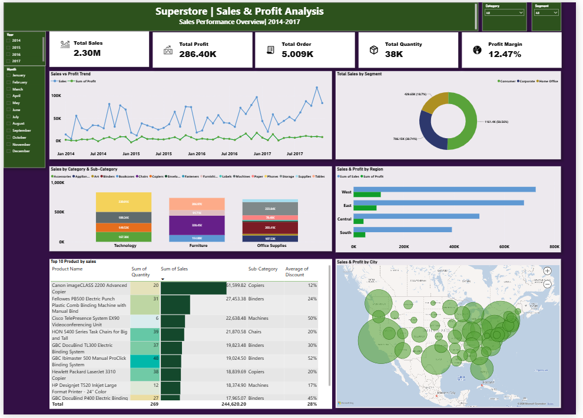
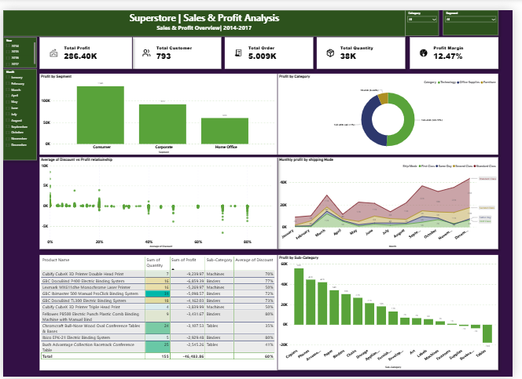

# Superstore Sales & Profit Analysis | Power BI

## Project Overview

In this project, I used Power BI to explore the sales and profitability of a retail Superstore between 2014 and 2017.

I wanted to understand how the business was performing, which products and regions were generating the most sales, and where the company was losing money.

To make the analysis easier to explore, I created two interactive dashboards. The first focuses on overall sales performance, while the second looks more closely at profitability, discounts, and loss-making products.

This project helped me practice working with business data, creating useful visualizations, and turning numbers into insights that could support business decisions.

## Tools Used

- **Power BI Desktop** — Building interactive dashboards
- **Power Query** — Preparing and transforming data
- **DAX** — Creating calculations and KPIs
- **Data Visualization** — Presenting information through charts, tables, and maps

## Dataset

I used the Sample Superstore dataset, which contains retail order information from 2014 to 2017.

The dataset includes order dates, sales, profit, discounts, quantities, customer segments, product categories, and geographic information.

## Key Performance Indicators

| Metric | Value |
|---|---:|
| Total Sales | $2.30M |
| Total Profit | $286.40K |
| Total Orders | 5,009 |
| Total Quantity Sold | Approximately 38K |
| Total Customers | 793 |
| Profit Margin | 12.47% |

These figures provide an overview of the company's performance across the four-year period.

## Dashboard 1: Superstore Sales Performance

The first dashboard focuses on understanding how sales are distributed across different products, customer segments, and regions.

I included a monthly sales and profit trend to see how performance changed over time. I also compared sales across categories and sub-categories to identify which product groups contributed the most revenue.

The regional comparison and map help explore where sales are coming from, while the product table highlights the highest-selling products.

**Main areas covered:**

- Monthly sales and profit trends
- Sales by category and sub-category
- Sales by customer segment
- Sales and profit by region
- Top-selling products
- Geographic sales distribution

## Dashboard 2: Superstore Profitability Insights

For the second dashboard, I focused on profitability rather than just sales.

One of my main goals was to understand why some products generate losses even when the business is making sales.

I compared profit across customer segments, product categories, and sub-categories. I also created a scatter plot to explore the relationship between discounts and profit.

Another important part of this dashboard is the loss-making products table, which helps identify products that may need closer attention.

**Main areas covered:**

- Profit by customer segment
- Profit by product category
- Profit by sub-category
- Discount and profit relationship
- Monthly profit by shipping mode
- Products generating the highest losses

## What I Found

### 1. Sales and Profit Tell Different Stories

The Superstore generated approximately **$2.30 million in sales**, but its total profit was around **$286,400**, giving an overall profit margin of **12.47%**.

This shows why it's important to look at profitability alongside revenue when evaluating business performance.

### 2. Profitability Varies Across Product Categories

Technology and Office Supplies contribute a large share of overall profit, while Furniture contributes much less.

This suggests that not every product category is equally profitable, even when it generates sales.

### 3. Regional Performance Is Different

Sales and profit are not distributed equally across regions.

By comparing both measures, I could explore which regions performed strongly and which might need more attention.

### 4. Some Products Generate Losses

The product-level analysis revealed several items with negative profit.

These products are worth investigating further to understand whether pricing, discounts, or other costs are affecting their performance.

### 5. Discounts Are Worth Investigating

The discount and profit scatter plot shows how profitability varies at different discount levels.

It provides a useful starting point for investigating whether heavily discounted products are associated with lower profits.

## Business Recommendations

Based on the analysis, I would suggest the following actions:

1. **Review loss-making products.** Investigate products with negative profit and assess whether their pricing or discount levels need adjustment.
2. **Monitor discounts more carefully.** Compare profit margins at different discount levels before making discount decisions.
3. **Focus on profitable product categories.** Explore opportunities to increase sales of products that contribute positively to overall profit.
4. **Compare sales and profit by region.** High sales alone should not be treated as a sign of strong performance.
5. **Track performance over time.** Use monthly trends to identify changes in sales and profitability.

## What I Learned

Working on this project helped me improve my Power BI skills and understand how different visualizations can answer business questions.

I gained more experience with data preparation, DAX calculations, KPI cards, slicers, charts, maps, and interactive reports.

I also learned that creating a dashboard is not just about displaying numbers. It's about choosing the right information, making it easy to understand, and using it to identify areas where a business could improve.

## Project Files

- `Superstore_Sales_Profit_Analysis.pbix` — Power BI report
- `Sales_Dashboard.png` — Sales Performance dashboard
- `Profitability_Dashboard.png` — Profitability Insights dashboard
- `README.md` — Project documentation

## Conclusion

This project gave me practical experience analyzing retail business performance using Power BI.

By building separate dashboards for sales and profitability, I was able to look beyond total revenue and explore product performance, regional differences, discounts, and losses.

It is part of my data analyst portfolio and demonstrates my ability to organize data, build interactive reports, and communicate business insights clearly.
